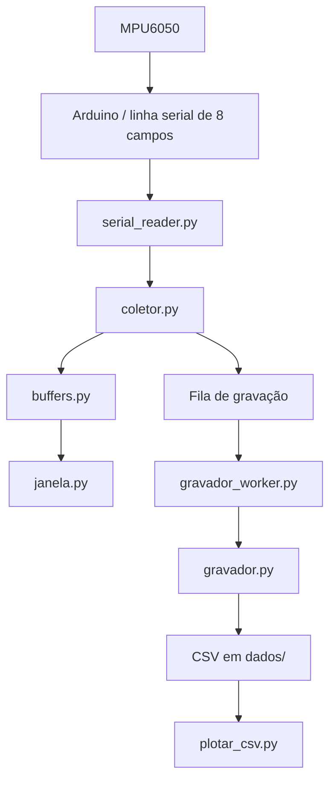

# Índice da documentação — PROJETO_SENSOR_VIBRACAO

> [!abstract] Como navegar
> Este índice é o mapa de entrada para o caminho completo de uma amostra: do
> MPU6050 ao CSV, à interface em tempo real e à análise posterior.

## Organização da pasta `DOCS/`

```text
DOCS/
├── sensor/        # aquisição serial, buffer, fila e CSV
├── realtime/      # aplicação Qt, janela e utilitário de diagnóstico
├── canvases/      # mapas visuais navegáveis do Obsidian
├── arquitetura/   # contratos, fluxo, tempo/frequência e encerramento
├── analise/       # estatísticas, validação, Plotly e calibração
├── referencias/   # hardware MPU6050 e dependências
├── guias/         # roteiro de modificação do sistema
├── utilitarios/   # apoio à transferência para o Obsidian
├── superpowers/   # registros históricos de planejamento
└── INDEX.md        # ponto de entrada desta documentação
```

## Comece por aqui

1. [[teoria_vibração]] — intuição física, EDOs, amostragem e os limites de interpretar uma medição.
2. [[ARQUITETURA]] — visão geral comprovada do sistema.
3. [[arduino_mpu6050]] — firmware `mpu-6050.ino`: I2C, registradores, leitura e protocolo serial.
4. [[mpu6050_register_map]] — páginas do mapa de registradores usadas pelo firmware.
5. [[mpu6050_product_specification]] — escalas, sensibilidades e I2C usados pelo firmware.
6. [[serial_reader]] — conversão da linha serial em uma amostra Python.
7. [[coletor]] — ponto em que a amostra vira buffer, métricas e item de fila.
8. [[janela]] — interface principal que consome o buffer em tempo real.

## Mapa do fluxo de dados

> [!tip] Visão navegável no Obsidian
> Abra [[canvases/fluxo-aquisicao|Fluxo de aquisição]] para acompanhar uma
> amostra de ponta a ponta, [[canvases/concorrencia-encerramento|Concorrência e encerramento]] para entender threads e parada segura, ou [[canvases/interface-tempo-real|Interface em tempo real]] para observar a atualização da interface.



O fluxo acima descreve dependências comprovadas pelo código. [[main]] cria a
interface completa, enquanto [[grafico]] oferece uma janela alternativa de
diagnóstico para o eixo `ax`.

## Scripts documentados

| Nota | Script | Uso principal |
|---|---|---|
| [[sensor/__init__]] | `sensor/__init__.py` | Declara o pacote sem efeitos de inicialização. |
| [[serial_reader]] | `sensor/serial_reader.py` | Lê, valida e converte a linha serial. |
| [[coletor]] | `sensor/coletor.py` | Calcula Hz, detecta lacunas e encaminha a amostra. |
| [[buffers]] | `sensor/buffers.py` | Mantém a janela circular de amostras na RAM. |
| [[gravador]] | `sensor/gravador.py` | Escreve CSV em lotes. |
| [[gravador_worker]] | `sensor/gravador_worker.py` | Consome a fila de persistência em uma thread. |
| [[manager]] | `sensor/manager.py` | Coordena fila, coletor e gravador. |
| [[teste_manager]] | `sensor/teste_manager.py` | Exercita o pipeline vivo no terminal. |
| [[realtime/__init__]] | `realtime/__init__.py` | Declara o pacote sem iniciar a GUI. |
| [[main]] | `realtime/main.py` | Ponto de entrada da interface completa. |
| [[janela]] | `realtime/janela.py` | Mostra seis séries, controles e estatísticas. |
| [[grafico]] | `realtime/gráfico.py` | Diagnóstico visual mínimo de `ax`. |

## Comandos rápidos

```powershell
# Janela principal
python -m realtime.main

# Teste serial sem interface
python -m sensor.teste_manager

# Debug visual mínimo (somente ax)
python realtime\gráfico.py

# Plotly do último CSV
python grafico\plotar_csv.py

# Calibração simples com referência de 0,50 g RMS em az
python calibração\calibrar_vibracao.py 0.50
```

## Referências complementares

- [[teoria_vibração]] — base física e matemática antes de entrar nos detalhes do código.
- [[arduino_mpu6050]] — explicação em ordem do firmware que produz o sinal.
- [[mpu6050_register_map]] — referência dirigida aos endereços e bits efetivamente usados.
- [[mpu6050_product_specification]] — referência dirigida às faixas, sensibilidades e I2C efetivamente usados.
- [[protocolo-serial]] — contrato da linha que chega do Arduino.
- [[esquema-csv]] — contrato do arquivo persistido.
- [[threads-e-encerramento]] — sequência de parada cooperativa e `join()`.
- [[tempo-frequencia-e-perdas]] — interpretação de Hz e das métricas de perda.
- [[statistics]] — medidas descritivas exibidas na interface.
- [[guia-de-modificacao]] — impactos de mudanças no protocolo ou nas etapas.
#PROJETO_SENSOR_VIBRAÇÃO
