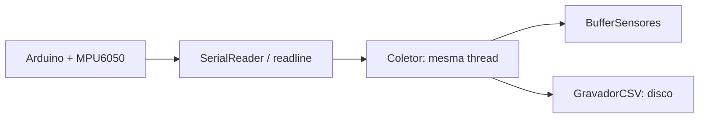
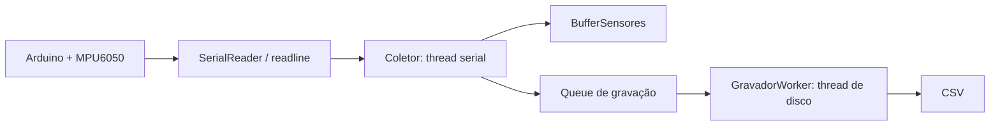

# Investigação e correção de perda de amostras

> Projeto: Sistema de aquisição de vibração com Arduino, MPU6050 e Python  
> Data da investigação: 29/07/2026  
> Estado: correção de gravação assíncrona implementada e validada sem interface gráfica.

## Resumo executivo

O Arduino enviava linhas no formato:

```text
contador,micros,ax,ay,az,gx,gy,gz
```

O contador ocasionalmente apresentava saltos grandes no Python, por exemplo:

```text
1851
1852
1853
3272
3273
```

O Arduino não reiniciava: o salto significava que o programa Python deixou de consumir a porta serial durante tempo suficiente para os buffers da comunicação USB/serial perderem bytes.

A principal causa arquitetural encontrada foi que a mesma thread responsável por `readline()` também gravava o CSV no disco. A escrita de um lote podia atrasar a próxima leitura serial. A correção separa aquisição e gravação com uma fila (`Queue`) e uma thread dedicada ao CSV.

## Fluxo anterior



O problema não era o `readline()` isoladamente. O ponto crítico era o que acontecia **entre uma chamada de `readline()` e a seguinte**.

### Caminho crítico anterior

No `Coletor`, após receber uma amostra, o código fazia as operações abaixo na thread serial:

```python
self.buffer.adicionar(
    tempo_arduino_us, timestamp, contador, ax, ay, az, gx, gy, gz
)

self.gravador.salvar([
    tempo_arduino_us,
    timestamp,
    contador,
    ax,
    ay,
    az,
    gx,
    gy,
    gz,
])
```

O método `salvar()` acumulava linhas e, ao atingir 1.000 registros, escrevia no arquivo:

```python
if len(self.buffer) >= self.tamanho_buffer:
    self.writer.writerows(self.buffer)
    self.buffer.clear()
```

`writerows()` é I/O de disco. A duração não é garantida: cache do sistema, antivírus, carga da máquina e arquivo podem introduzir pausas. Durante essa pausa, o gerador `ler_dados()` não é retomado e o próximo `readline()` não acontece.

Como o Arduino continua enviando, os buffers USB/driver — que são finitos — podem transbordar. Quando o Python volta a ler, recebe uma linha posterior; por isso o contador parece “pular”. Linhas parciais observadas depois de uma pausa longa são evidência compatível com perda de bytes nesse caminho.

## Fluxo corrigido



O `Coletor` agora faz somente trabalho curto e previsível:

```text
readline → parse → detectar salto → atualizar buffer → enfileirar CSV
```

O disco foi retirado desse caminho.

## Alterações realizadas

### `sensor/coletor.py`

#### Remoção da escrita direta em disco

Antes, `Coletor` criava `GravadorCSV` e chamava `salvar()` diretamente. Agora ele recebe uma fila de gravação:

```python
def __init__(self, porta="COM4", baudrate=115200, fila_gravacao=None):
    self.fila_gravacao = fila_gravacao
```

Depois de atualizar o buffer, a amostra é enfileirada:

```python
self._enfileirar_gravacao([
    tempo_arduino_us,
    timestamp,
    contador,
    ax, ay, az,
    gx, gy, gz,
])
```

O enfileiramento não espera o disco:

```python
try:
    self.fila_gravacao.put_nowait(linha)
except Full:
    self.amostras_nao_enfileiradas += 1
```

`put_nowait()` é deliberado: a thread serial não deve parar esperando a gravação. Caso a fila fique cheia, o programa registra explicitamente o problema em `amostras_nao_enfileiradas`, em vez de permitir perda silenciosa nos buffers do driver serial.

#### Detector de saltos

Foram adicionadas as métricas:

```python
self.saltos_contador = 0
self.amostras_perdidas = 0
self.amostras_nao_enfileiradas = 0
```

O detector compara o contador atual com o anterior:

```python
if contador > self.contador_anterior + 1:
    perdidas = int(contador - self.contador_anterior - 1)
    self.saltos_contador += 1
    self.amostras_perdidas += perdidas
```

Isso torna a perda mensurável. Um salto deixa de depender apenas de inspeção visual do console.

#### Primeira amostra

Antes, a primeira amostra válida era ignorada por um `continue`, pois não havia amostra anterior para calcular Hz instantâneo. Agora ela é guardada no buffer e no CSV; apenas o cálculo de frequência é adiado para a segunda amostra.

#### Ajuste de Hz médio

O número de intervalos entre `n` amostras é `n - 1`. Portanto:

```python
self.hz_medio = (self.numero_amostras - 1) / dt_total
```

é mais correto do que dividir `n` por `dt_total`.

### `sensor/gravador_worker.py` — novo arquivo

Este é o único novo componente de execução. Ele possui uma única responsabilidade: consumir a fila e usar a classe já existente `GravadorCSV`.

```python
class GravadorWorker(Thread):
    def run(self):
        gravador = GravadorCSV(tamanho_buffer=self.tamanho_buffer)

        while True:
            linha = self.fila.get()
            try:
                if linha is None:
                    break

                gravador.salvar(linha)
            finally:
                self.fila.task_done()

        gravador.fechar()
```

`None` é um sentinela de encerramento. Quando o programa para, o worker termina de gravar o lote que restou na memória e fecha o arquivo.

### `sensor/manager.py`

O `SensorManager` continua sendo o controlador de iniciar/parar. Ele passou a criar a fila e iniciar os dois workers na ordem correta:

```python
self.fila_gravacao = Queue(maxsize=50_000)
self.coletor.configurar_fila_gravacao(self.fila_gravacao)

self.gravador_thread = GravadorWorker(self.fila_gravacao)
self.gravador_thread.start()

self.thread = Thread(target=self.coletor.executar, daemon=True)
self.thread.start()
```

Na parada, primeiro encerra a aquisição; depois avisa o gravador para finalizar:

```python
self.coletor.parar()
self.thread.join()
self.fila_gravacao.put(None)
self.gravador_thread.join()
```

Isso evita fechar o CSV enquanto o coletor ainda tenta enviar registros.

### `sensor/buffers.py`

O buffer continua usando os nove `deque`s existentes para preservar compatibilidade com o projeto atual. Foram adicionados:

- `Lock` para proteger a inserção conjunta dos nove valores;
- `tamanho_atual()`;
- `snapshot(quantidade)`, que copia todos os sinais do mesmo intervalo de amostras;
- `limpar()`.

Exemplo de snapshot consistente:

```python
dados = buffer.snapshot(1000)
ax = dados["ax"]
ay = dados["ay"]
contador = dados["contador"]
```

O lock só fica ativo durante nove `append`s ou durante a cópia curta do snapshot. Ele não fica ativo durante comunicação serial, gravação de arquivo ou renderização gráfica.

Isso não era a causa principal dos saltos de contador, mas evita que a interface obtenha `ax` de um instante e `ay` de outro.

### `sensor/serial_reader.py`

Não foi modificado durante a correção da fila/CSV. O timeout foi ajustado posteriormente para `0.1 s`, o que melhora o tempo de resposta do encerramento.

Os `print()` por amostra foram preservados para depuração. Eles continuam sendo um possível gargalo em execuções longas, pois são I/O síncrono e muito frequente. A correção atual removeu o I/O de disco do caminho crítico, mas não torna logging por amostra gratuito.

## Evidências experimentais

### 1. Enlace serial isolado

Teste real em `COM4`, `115200 baud`, por 20 segundos, sem interface e sem CSV:

| Métrica | Resultado |
|---|---:|
| Linhas válidas | 4.238 |
| Linhas inválidas | 1 |
| Taxa média | 211,89 Hz |
| Saltos de contador | 0 |
| Amostras perdidas | 0 |
| Maior intervalo de chegada no PC | 6,893 ms |
| Maior delta observado em `micros()` | 4.740 µs (aprox. 4,74 ms) |

Conclusão: Arduino, CH340, cabo/porta COM4 e baudrate 115200 estavam estáveis quando o consumidor Python lia continuamente.

### 2. Coletor + fila + CSV, sem GUI

Teste real com o código corrigido, durante aproximadamente 20 segundos úteis após o tempo de inicialização do Arduino:

| Métrica | Resultado |
|---|---:|
| Amostras recebidas | 4.323 |
| Saltos | 0 |
| Perdas seriais detectadas | 0 |
| Amostras não enfileiradas para CSV | 0 |
| Amostras no buffer | 4.323 |
| Erro do gravador | nenhum |
| Linhas no CSV | 4.324 (cabeçalho + 4.323 dados) |

O arquivo gerado no ensaio foi `dados/dados_aceleracao_giro-2026-07-29_19-43-02.csv`.

**Importante:** para medir a arquitetura de aquisição/CSV, a saída do console foi suprimida somente durante esse teste. Isso não altera arquivos nem remove os prints do código. Portanto, o teste prova o caminho serial + fila + CSV; ainda é necessário testar uma execução longa com a janela e com o nível desejado de logging.

## Como testar sem a interface

1. Fechar qualquer programa que esteja usando a `COM4` (Arduino Serial Monitor, PyQt anterior etc.).
2. Abrir PowerShell na raiz do projeto.
3. Executar:

```powershell
.\.venv\Scripts\python.exe sensor\teste_manager.py
```

4. Deixar rodar por pelo menos 60 segundos.
5. Encerrar com `Ctrl+C`.

### Critérios de aprovação

```text
saltos_contador = 0
amostras_perdidas = 0
amostras_nao_enfileiradas = 0
fila CSV não cresce continuamente
```

O buffer visual chega a 10.000 amostras e permanece nesse tamanho; isso é normal porque ele é circular. O contador do Arduino e o CSV devem continuar crescendo.

## O que ainda precisa ser feito

### 1. Janela atualizada para usar `snapshot(1000)`

A interface passou a usar um snapshot sincronizado de 1.000 pontos por frame:

```python
dados = self.manager.buffer.snapshot(1000)

self.curva_ax.setData(dados["ax"])
self.curva_ay.setData(dados["ay"])
# demais curvas...
```

Com isso, a janela desenha apenas os últimos 1.000 pontos, todos sincronizados. O contador da amostra passou a ser o eixo X, permitindo visualizar uma eventual lacuna real de aquisição.

### 2. Atualização da interface a 30 FPS

Para monitoramento de vibração, 30 FPS é visualmente fluido e reduz a carga do processo:

```python
self.timer.start(33)  # aproximadamente 30 FPS
```

A taxa de aquisição continua aproximadamente 212 Hz; a UI não precisa desenhar cada amostra individualmente. As estatísticas de `Ax` são atualizadas separadamente, quatro vezes por segundo, com média, desvio padrão e RMS.

### 3. Telemetria exibida na UI

O painel agora exibe:

- amostras recebidas;
- saltos de contador;
- amostras perdidas;
- amostras não enfileiradas para CSV;
- ocupação da fila CSV;
- taxa média de aquisição.

### 4. Tornar o debug configurável

Os prints detalhados são úteis agora, mas devem ser controlados por uma configuração, por exemplo:

```python
DEBUG_SERIAL = True

if DEBUG_SERIAL:
    print("Recebi bytes:", repr(dados_linha))
```

Em ensaios longos, desativar prints por amostra é necessário para evitar que o terminal se torne um novo gargalo.

## O código ficou mais complexo?

Pouco. A separação necessária adicionou apenas uma fila e um worker novo. O restante foi reaproveitado:

| Componente existente | Situação |
|---|---|
| `ler_dados()` | mantido |
| `Coletor` | mantido, sem escrita em disco |
| `BufferSensores` | mantido, agora sincronizado |
| `GravadorCSV` | mantido |
| `SensorManager` | mantido, agora controla duas threads |
| `Janela` | ainda não alterada |
| Novo componente | somente `GravadorWorker` |

É possível futuramente unir `GravadorWorker` e `GravadorCSV` em uma única classe, mas mantê-los separados é didaticamente útil: uma classe sabe **como escrever CSV**, a outra sabe **como consumir uma fila em thread**.

## Conclusão

O salto do contador não era causado pelo sensor nem pelo parser como causa primária. Ele era compatível com o atraso da thread consumidora da serial. Ao remover a gravação CSV síncrona dessa thread, os testes reais não apresentaram perdas.

O próximo risco a validar é a interface gráfica e o logging intenso. A mudança seguinte deve ser fazer a janela consumir `BufferSensores.snapshot(1000)` e reduzir a quantidade de pontos/FPS desenhados.
